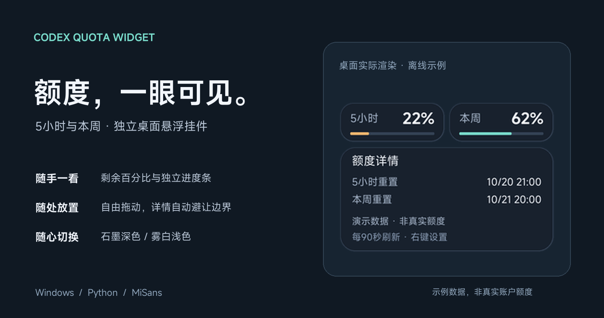
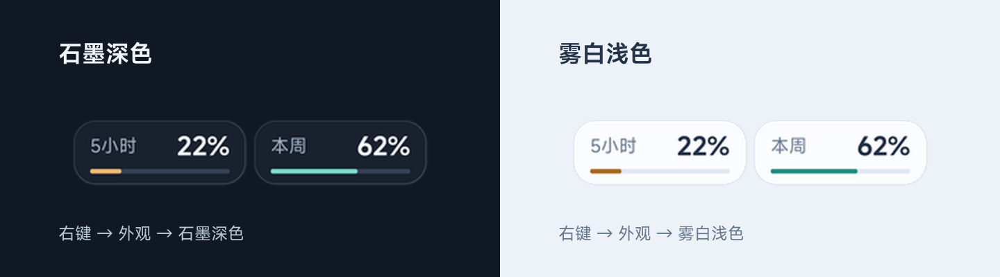
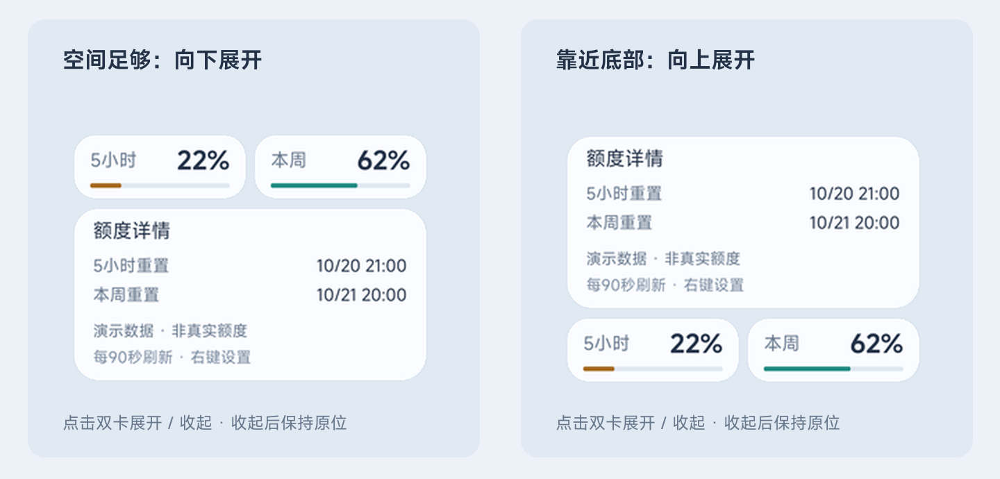

# 额度挂件 · Codex Quota Widget

把 Codex 的 **5 小时 / 本周剩余额度**放在桌面上。两张轻巧的卡片，点击查看重置时间，拖动到顺手的位置。



> 图片由程序实际绘制，使用明确标记的离线演示数据，非作者账户的真实额度。

## 可以做什么

- **查看剩余额度**：两项百分比、两条独立进度条；25% 及以下变为低额度色。
- **展开详情**：显示两个额度窗口的重置时间、最近更新状态；时间统一使用北京时间（UTC+8）。
- **自动避让屏幕边界**：靠近底部时向上展开，收起后回到原位，支持多显示器和任务栏避让。
- **切换深浅外观**：石墨深色 / 雾白浅色，MiSans 字体、平滑透明圆角。
- **安静常驻**：隐藏控制台启动、单实例、可选置顶，记住窗口位置与外观。
- **自动刷新**：每 90 秒更新，也可按 F5 手动刷新；缺失、超过 180 秒或已到重置时间的数据显示为 `—`，等待服务端确认。

这是独立的 Windows 桌面挂件。项目只提供额度双卡，不包含宠物显示、精灵图或动画，也不向官方宠物工具栏注入按钮。

## 外观预览



两张卡的颜色分别取决于各自的剩余额度。图中 5 小时为低额度色，本周仍为正常色。



## 快速开始

需要 **Windows 10/11、Python 3.12+（含 Tk）、Pillow**，以及已经登录的 Codex 桌面运行时或 Codex CLI。建议使用 Python 3.12；目前已在该版本验证。不需要配置 OpenAI API Key。

### 1. 获取代码

```powershell
git clone https://github.com/Halcyea/codex-quota-widget.git
cd codex-quota-widget
```

也可以从仓库的 **Code → Download ZIP** 下载并解压。请将项目放在当前用户可写的目录中。

### 2. 安装依赖

```powershell
python -m pip install -r requirements.txt
```

如果使用虚拟环境，可在项目目录创建 `.venv` 并在其中安装依赖；VBS 启动器优先使用 `.venv\Scripts\pythonw.exe`。

### 3. 启动

双击 **`start-pet.vbs`**，即可无控制台启动；也可以双击 `start-pet.cmd`。脚本沿用旧文件名，方便已有快捷方式继续使用。

首次排查问题时，建议在终端运行，以便看到错误：

```powershell
python app.py
```

可选：在项目目录执行以下命令，创建桌面 **额度挂件** 快捷方式。脚本会避开不属于本项目的同名快捷方式。

```powershell
powershell -NoProfile -ExecutionPolicy Bypass -File .\create-desktop-shortcut.ps1
```

### 4. 操作

| 操作 | 效果 |
| --- | --- |
| 单击双卡 / Enter | 展开或收起详情 |
| 按住左键拖动 | 移动挂件，松开后保存位置 |
| 右键 | 刷新、详情、置顶、外观和退出 |
| F5 | 手动刷新额度 |
| Esc / 右键退出 | 正常关闭并保存偏好 |
| 双击 `stop-widget.vbs` | 请求正在运行的实例退出 |

键盘快捷键需窗口获得焦点。程序不会自动设置开机启动。

## 数据从哪里来

通过本机 Codex 的 App Server，以 stdio JSON-RPC 调用 `account/rateLimits/read`。优先读取 `rateLimitsByLimitId.codex`，兼容旧 `rateLimits` 格式；根据窗口时长识别 5 小时和一周额度，不混入其他模型的额度。

剩余额度为 `100 - usedPercent`。重置时间到达时会重新查询，**不会自行把额度改成 100%**。当前服务返回什么窗口和时间，就显示相应结果；“本周”标签对应服务端返回的周时长窗口。

挂件不发起模型推理，不购买额度、不使用重置次数，也不直接读取或复制登录令牌。查询子进程沿用 Codex 自身已有的登录与网络设置。

若自动发现失败，可显式指定原生可执行文件（应为 `codex.exe`，不能是 `.ps1` 或 `.cmd` 包装脚本）：

```powershell
$env:PET_ENERGY_CODEX = 'C:\path\to\codex.exe'
python app.py
```

## 常见问题

| 现象 | 处理方式 |
| --- | --- |
| 显示 `—` | 可能正在读取、无对应窗口、数据过期或正在等待服务端确认重置。点开详情后按 F5。 |
| 提示连接未成功 | 确认 Codex 已登录且网络可用；用 `python quota.py` 查看只读查询结果。不要把含账户数据的输出直接发到公开 Issue。 |
| 找不到 Codex | 确认原生运行时已安装，或设置 `PET_ENERGY_CODEX`。 |
| 双击没有反应 | 先执行 `python app.py`；确认启动器所使用的 Python 已安装 Pillow 和 Tk。 |
| 想重置位置和外观 | 退出程序后，删除本地 `.runtime/settings.json`，再启动。 |
| 其他系统能用吗 | 当前仅面向 Windows；透明合成、字体注册和启动器依赖 Windows。 |

App Server 接口可能随 Codex 版本变化；遇到兼容问题可提交 Issue，并附上版本、错误说明和已脱敏的信息。

## 本地文件与隐私

运行时在项目内创建 `.runtime/`，保存位置与外观、诊断状态、额度快照和应用日志。**这些文件仅用于本机诊断，已被 Git 忽略，不随仓库上传。** 公开分享日志或截图前，请自行检查其中的账户信息。

仓库不包含登录文件、真实账户额度、宠物素材、个人开发日志或本机桌面快捷方式。

## 开发与验证

```powershell
python -m unittest discover -s tests -v
python app.py --self-check
```

32 项自动检查覆盖额度解析、数据过期、后台刷新与退出、多显示器位置、预乘透明像素和完整帧提交。Windows 窗口自检覆盖字体、双主题、平滑圆角、上下展开、拖动、置顶及 GDI 资源释放，不请求真实额度、不覆盖运行实例设置。

离线演示：`python app.py --demo 20`。重新生成本文插图：`python tools/render_readme.py`。两者均不连接额度服务。

模块职责和布局细节见 [DEVELOPMENT.md](DEVELOPMENT.md)。

## 字体与第三方资源

本软件使用 **MiSans**，保留小米官方原始 Regular / Semibold 字体，仅在当前进程内注册。来源、校验值及第三方许可见 [字体说明](THIRD_PARTY_NOTICES.md) 和 [官方许可原文](assets/fonts/MiSans-LICENSE.pdf)。
